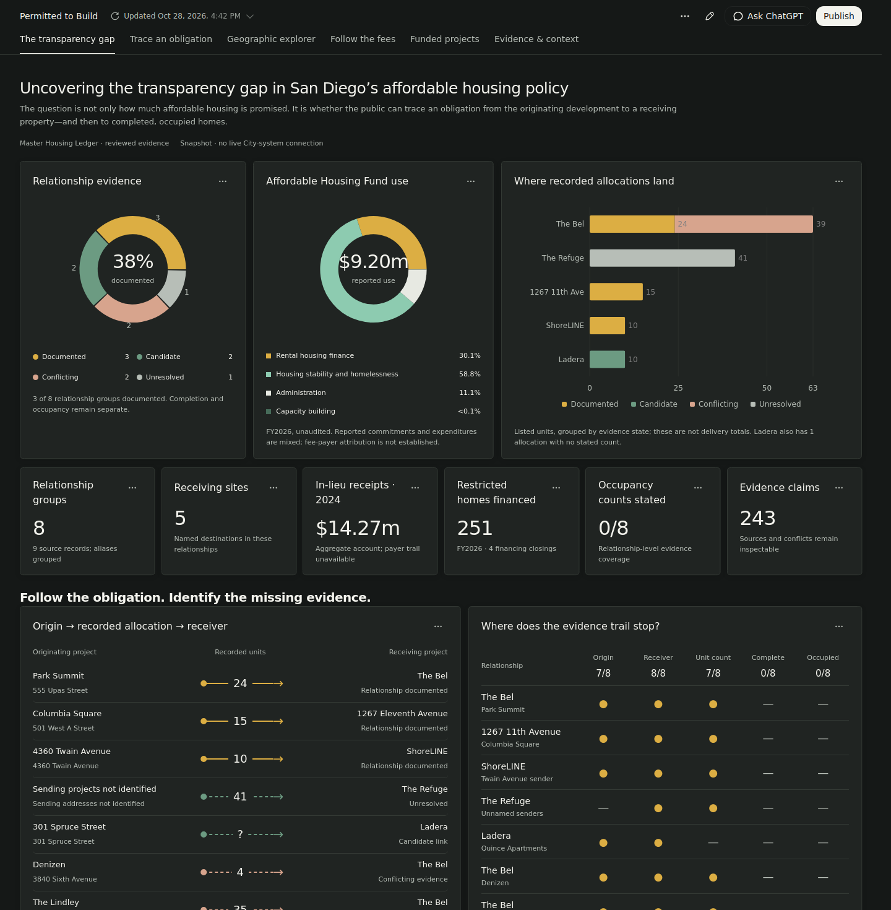

# Permitted-to-build
Research ledger and interactive dashboard tracing San Diego affordable housing obligations, receiving sites, and evidence gaps.

## Updated dashboard design

The completed working build adopts the supplied charcoal-panel reference, with gold and mint charts, white figures and a compact grid. It preserves all six analytical views: transparency-gap overview, relationship explorer, geographic explorer, fee pathways, funded projects, and searchable evidence and source context.

The working build retains all 23 original query row sets, source lineage, conflicts and unknown delivery counts. It includes the map controls, exact-unit diagrams, opportunity comparisons, filters, URL selections, source inspection and documented discrepancies.

Verification: 38 data/integrity checks and 25 real-browser checks, including desktop, 320px/390px mobile, landscape, chart rendering, source inspection, map controls and funding drill-down.

## Hosting status

This repository currently displays the visual preview. The full GitHub Pages deployment has not completed because the large connected upload stalled. Automatic research ingestion is not connected.
